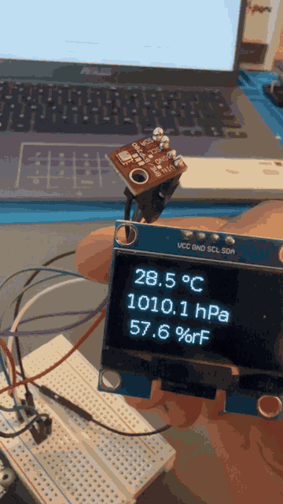
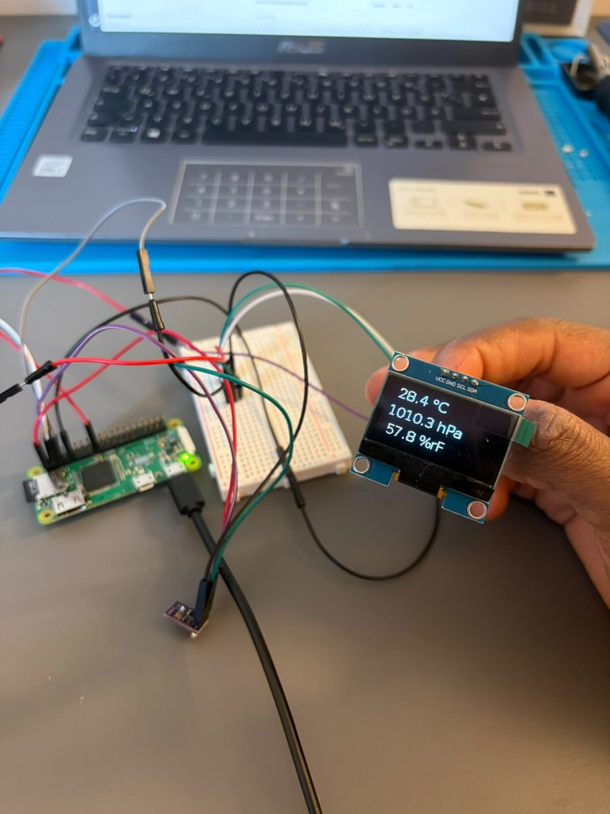

# IoT Sensor Station 🌡️

[](https://github.com/rascho2/sensor-station/actions/workflows/ci.yml)

A Raspberry Pi Zero W that measures **temperature, humidity and air pressure** with a Bosch BME280 and shows the live readings on a small OLED display.
The BME280 driver is written from scratch on top of raw I2C register access, including the sensor's factory calibration.

This is the first stage of a full-stack IoT project: the Pi publishes its readings via MQTT, and a FastAPI backend on the laptop stores them in SQLite and serves them over a REST API and a live web dashboard (see [Roadmap](#-roadmap)).

<p align="center">
  
  &nbsp;
  
</p>

---

## 📁 Repository layout

```
device/    runs on the Raspberry Pi: BME280 driver, OLED, MQTT publisher, systemd service
backend/   runs on the laptop: MQTT subscriber, SQLite storage, REST API (FastAPI), web dashboard
mosquitto/ configuration of the Mosquitto broker container
docs/      images for this README
docker-compose.yml   runs Mosquitto and the backend on the laptop
```

---

## ✨ Features

- Reads temperature (°C), pressure (hPa) and relative humidity (%) every 2 seconds
- **Own BME280 driver** using only `smbus2`:
  - detects BME280 vs. BMP280 via the chip ID register
  - reads the per-sensor factory calibration coefficients from the sensor's NVM
  - applies Bosch's compensation formulas to turn raw ADC values into physical units
  - burst-reads all measurement registers at once so values belong to the same sample
- **Forced mode** instead of continuous measuring, to minimise self-heating of the sensor
- Live output on a **1.3" SH1106 OLED** (128×64) via `luma.oled`
- Keeps running with console output only if the display or `luma.oled` is missing
- Publishes every reading as **JSON via MQTT** (`paho-mqtt`), with automatic reconnect if the broker is unreachable

---

## 🔧 Hardware

| Component | Details |
|-----------|---------|
| Raspberry Pi Zero W | Raspberry Pi OS Lite (32-bit), headless via SSH over Wi-Fi |
| BME280 breakout | I2C address `0x76`, chip ID `0x60` |
| 1.3" OLED | SH1106 driver, 128×64, I2C address `0x3C` |
| Breadboard + jumper wires | to share the I2C bus between both devices |

Both devices share **I2C bus 1** (SDA/SCL are joined on the breadboard).

### Wiring

| Signal | Raspberry Pi pin | BME280 | OLED |
|--------|------------------|--------|------|
| 3.3 V  | Pin 1            | VIN    | –    |
| 3.3 V  | Pin 17           | –      | VCC  |
| GND    | Pin 6            | GND    | –    |
| GND    | Pin 9            | –      | GND  |
| SDA    | Pin 3 (GPIO2)    | SDA    | SDA  |
| SCL    | Pin 5 (GPIO3)    | SCL    | SCL  |

Check the I2C bus with `i2cdetect -y 1`. It should show `3c` (OLED) and `76` (BME280).

---

## 🚀 Setup & run (device)

On the Pi, the contents of `device/` live directly in `~/sensor-station` (next to the venv). Copy them over from the laptop:

```bash
# On the laptop, in the repo (sensorpi.local or the Pi's current IP)
rsync -av --exclude '__pycache__' --exclude 'sensorstation.env' device/ rashid@sensorpi.local:sensor-station/
```

On the Raspberry Pi:

```bash
# Enable I2C (once)
sudo raspi-config nonint do_i2c 0

# Install dependencies in a virtual environment
cd ~/sensor-station
python3 -m venv venv
venv/bin/pip install -r requirements.txt

# Run manually (display + console only)
venv/bin/python sensor.py

# Run and also publish every reading via MQTT
venv/bin/python sensor.py --mqtt-host 172.20.10.6            # port defaults to 1883
venv/bin/python sensor.py --mqtt-host 172.20.10.6 --mqtt-port 1884
MQTT_HOST=172.20.10.6 venv/bin/python sensor.py              # same via environment variable
```

Command-line arguments take precedence over the environment variables `MQTT_HOST` / `MQTT_PORT`.

### Run as a systemd service

For normal operation, `sensor.py` runs as the systemd service `sensorstation`. It starts automatically at boot once the network is up and restarts after 5 seconds if it crashes.

```bash
cd ~/sensor-station
./install-service.sh
```

The script installs the dependencies, creates `~/sensor-station/sensorstation.env` from `sensorstation.env.example` on first run (never overwrites it), copies the unit to `/etc/systemd/system/`, then enables and starts the service. It refuses to run while a manually started `sensor.py` is still running, so two instances never run in parallel. You can run it again after updating the code or the unit.

**Change the broker IP** (e.g. after the hotspot assigned a new address):

```bash
nano ~/sensor-station/sensorstation.env       # MQTT_HOST=172.20.10.6
sudo systemctl restart sensorstation
```

**Everyday commands:**

| Task | Command |
|------|---------|
| Status | `systemctl status sensorstation` |
| Live logs | `journalctl -u sensorstation -f` |
| Logs since last boot | `journalctl -u sensorstation -b` |
| Restart (e.g. after updating `sensor.py`) | `sudo systemctl restart sensorstation` |
| Stop / start | `sudo systemctl stop sensorstation` / `sudo systemctl start sensorstation` |
| Disable autostart | `sudo systemctl disable --now sensorstation` |

> Stop the service before running `sensor.py` by hand, otherwise both access the sensor and the display at the same time.

What the unit file (`device/sensorstation.service`) does:

| Line | Meaning |
|------|---------|
| `Wants=` / `After=network-online.target` | start only once the network is actually up (not just once networking has started) |
| `User=rashid` | run as a normal user, not as root; the `i2c` group grants access to the sensor |
| `WorkingDirectory=` | `sensor.py` is started relative to `~/sensor-station` |
| `EnvironmentFile=` | reads `MQTT_HOST` / `MQTT_PORT` from `sensorstation.env` |
| `Environment=PYTHONUNBUFFERED=1` | print output reaches the journal immediately instead of in blocks |
| `ExecStart=…/venv/bin/python sensor.py` | uses the venv's Python, so `luma.oled` and `paho-mqtt` are available |
| `KillSignal=SIGINT` | stopping works like Ctrl+C: the script disconnects cleanly from the broker |
| `Restart=on-failure`, `RestartSec=5` | restart 5 s after a crash, but not after a normal stop |
| `WantedBy=multi-user.target` | `systemctl enable` hooks the service into the normal boot |

### MQTT

With `--mqtt-host`, every reading is published (QoS 0) to the topic `sensorstation/<hostname>/messwerte`, e.g. `sensorstation/sensorpi/messwerte`:

```json
{"timestamp": "2026-10-20T15:42:07+02:00", "temperature_c": 23.41, "pressure_hpa": 1012.37, "humidity_pct": 48.2}
```

`humidity_pct` is `null` on a BMP280. If the broker is unreachable or the connection drops, measuring and the display keep running; the script prints a note once and reconnects automatically in the background. The broker address is configurable (argument, environment variable or `sensorstation.env`) because the IP can change (e.g. on a phone hotspot).

To watch the messages on the broker machine:

```bash
mosquitto_sub -h localhost -t 'sensorstation/#' -v
```

Example output:

```
BME280 gefunden an Bus 1, Adresse 0x76. Abbrechen mit Strg+C.

13:45:11  Temperatur:  26.91 °C   Druck: 1010.74 hPa   Feuchte:  54.3 %
13:45:13  Temperatur:  26.90 °C   Druck: 1010.73 hPa   Feuchte:  54.3 %
```

> Run the script with the venv's Python (`venv/bin/python`). With the system `python3`, `luma.oled` is not available and the script falls back to console output only.

---

## 🖥️ Backend

The backend runs on the laptop next to the Mosquitto broker. It subscribes to `sensorstation/+/messwerte`, validates every message, stores it in SQLite and serves the data over a REST API and a [web dashboard](#-dashboard).

### Start with Docker (recommended)

`docker-compose.yml` runs two containers: the **Mosquitto** broker (`eclipse-mosquitto:2.0.22`, port 1883) and the **backend** (port 8000). Both restart automatically after a crash or a reboot of the laptop, unless you stopped them yourself.

> **Mosquitto must not run as a system service at the same time**, otherwise port 1883 is taken and the container cannot start. Stop and disable it once:
>
> ```bash
> sudo systemctl disable --now mosquitto     # stop now + no autostart at boot
> systemctl is-active mosquitto              # → inactive
> ss -ltn | grep 1883                        # → no output, port is free
> ```
>
> To go back: `docker compose down`, then `sudo systemctl enable --now mosquitto`.

```bash
docker compose up -d --build      # build the backend image and start both containers
docker compose ps                 # status; the backend shows "healthy" after a few seconds
```

Dashboard: <http://localhost:8000/>. The Pi keeps sending to `<laptop-ip>:1883` as before, nothing changes on the device.

| Task | Command |
|------|---------|
| Status | `docker compose ps` |
| Live logs (both / one service) | `docker compose logs -f` / `docker compose logs -f backend` |
| Last 50 lines | `docker compose logs --tail 50 mosquitto` |
| Watch MQTT messages | `docker compose exec mosquitto mosquitto_sub -t 'sensorstation/#' -v` |
| Restart after a code change | `docker compose up -d --build` |
| Stop (containers are removed, data stays) | `docker compose down` |
| Stop **and delete all data** | `docker compose down -v` |

What is where:

- `backend/Dockerfile`: `python:3.12-slim`, only `requirements.txt` (no test tools), runs as the unprivileged user `sensorstation`, not as root. `backend/.dockerignore` keeps venv, database and caches out of the image.
- `mosquitto/config/mosquitto.conf`: listener on port 1883 without login (as before, only use it in your own network), logs to stdout so `docker compose logs` shows them.
- Inside the Compose network the backend reaches the broker by its service name: `MQTT_HOST=mosquitto`.
- The SQLite database lives in the Docker volume `backend-data` (`/data/sensorstation.db` in the container), Mosquitto's persistence in `mosquitto-data`. Both survive `docker compose down` and rebuilds; only `down -v` deletes them.
- Healthcheck: every 30 s, `GET /api/health` inside the container. It also counts as healthy when the broker is gone (`"degraded"`), because the API still serves stored data then.

Copy an existing database from `backend/data/` into the volume (once, before the first start):

```bash
docker compose run --rm --no-deps -v ./backend/data:/import:ro backend cp /import/sensorstation.db /data/
```

> Docker publishes ports directly via iptables, past `ufw`. Ports 1883 and 8000 are reachable from the whole network the laptop is in.

### Start without Docker

```bash
cd backend
python3 -m venv venv
venv/bin/pip install -r requirements.txt        # requirements-dev.txt for the tests
venv/bin/uvicorn app.main:app --host 0.0.0.0 --port 8000
```

Dashboard: <http://localhost:8000/> · interactive API docs (Swagger UI): <http://localhost:8000/docs>

Configuration via environment variables:

| Variable | Default | Meaning |
|----------|---------|---------|
| `MQTT_HOST` | `localhost` | MQTT broker address |
| `MQTT_PORT` | `1883` | MQTT broker port |
| `MQTT_TOPIC` | `sensorstation/+/messwerte` | subscribed topic (`+` = any device) |
| `DB_PATH` | `backend/data/sensorstation.db` | SQLite file (created automatically) |

```bash
MQTT_HOST=192.168.1.20 DB_PATH=/var/lib/sensorstation.db venv/bin/uvicorn app.main:app
```

### Endpoints

| Method & path | Description |
|---------------|-------------|
| `GET /api/health` | `{"status": "ok" \| "degraded", "database": true, "mqtt_connected": true}` |
| `GET /api/readings/latest` | newest reading, `404` if there is none yet |
| `GET /api/readings?limit=100&since=<ISO 8601>` | readings, newest first; `limit` 1–1000 (default 100), `since` is inclusive and must include a time zone |
| `GET /api/readings/aggregated?since=<ISO 8601>&bucket_seconds=60` | averages per time window, oldest first, for charts; `since` required, `bucket_seconds` 10–86400 (default 60), optional `device`. Each entry has `bucket_start`, `count` and the averaged values. Windows without readings are left out |

```bash
curl localhost:8000/api/readings/latest
# {"device":"sensorpi","timestamp":"2026-10-22T13:47:00Z","temperature_c":25.92,"pressure_hpa":1002.31,"humidity_pct":63.5}

curl -G localhost:8000/api/readings --data-urlencode "since=2026-10-22T15:00:00+02:00"

curl -G localhost:8000/api/readings/aggregated --data-urlencode "since=2026-10-22T00:00:00Z" -d bucket_seconds=300
# [{"device":"sensorpi","bucket_start":"2026-10-22T13:50:00Z","count":28,"temperature_c":26.04,"pressure_hpa":1002.33,"humidity_pct":62.5}, ...]
```

Timestamps are returned in UTC. In a URL, a `+` in the time zone offset must be encoded as `%2B` (`--data-urlencode` does that), or use `Z` for UTC.

### Architecture

```
Raspberry Pi                    Laptop
─────────────                   ──────────────────────────────────────────────────────
device/sensor.py ──MQTT/JSON──▶ Mosquitto ──▶ backend (one Python process)
                                                ├─ MQTT thread:  mqtt_subscriber.py
                                                │                  → messages.py (validate)
                                                │                  → db.py ──write──▶ SQLite
                                                └─ uvicorn:      main.py (FastAPI)
                                                                   → db.py ◀──read── SQLite
                                                                   → static/ (dashboard)
                                                                        ▲
                                         browser / curl ──HTTP/JSON─────┘
```

- `app/mqtt_subscriber.py`: a paho-mqtt client running in a background thread. It connects asynchronously, so the API also starts when no broker is running, and it reconnects automatically. It re-subscribes after every reconnect. Every exception in the message callback is caught, because an uncaught one would stop the MQTT thread for good.
- `app/messages.py`: turns topic + raw bytes into a validated `Reading`. The device name comes from the topic. The payload is checked with a strict pydantic model: no strings as numbers, time zone required, values within the BME280's measuring range. Invalid messages are logged and skipped. This module knows nothing about MQTT, which makes it testable without a broker.
- `app/db.py`: plain `sqlite3`. All timestamps are normalised to UTC before storing, so they sort and compare correctly as text. One short-lived connection per operation and WAL mode let the MQTT thread write while API requests read.
- `app/db.py` also does the aggregation for the charts in SQL: timestamp → Unix seconds, integer-divided by the window size, then `GROUP BY` with `AVG()`. 24 hours of data (~43,000 readings at one every 2 s) become at most 288 rows at 5-minute windows, without loading the raw data into Python.
- `app/main.py`: FastAPI app factory. The *lifespan* creates the schema and starts/stops the subscriber with the server. Query parameters and responses are validated by FastAPI (`422` on bad input). The dashboard in `app/static/` is mounted at `/` after the API routes, so `/api/...` and `/docs` keep priority.
- The MQTT client ID contains hostname and process ID. Two backend instances with the same ID would keep kicking each other off the broker.

### Tests

```bash
cd backend
venv/bin/pip install -r requirements-dev.txt
venv/bin/pytest
```

The tests use a temporary SQLite file per test and never need a broker: message parsing is tested directly, the MQTT callbacks are called with fake client/message objects, and the API runs with `start_mqtt=False` through FastAPI's `TestClient`.

### Lint and CI

```bash
backend/venv/bin/ruff check backend/ device/          # --fix applies the safe fixes
```

`ruff.toml` in the repo root configures ruff for both folders (Python 3.11 as target because of the Pi, `app` as own package for the import order). The ruff version is pinned in `requirements-dev.txt`, CI uses the same one.

GitHub Actions (`.github/workflows/ci.yml`) runs on every push and pull request, three jobs in parallel:

| Job | What it checks |
|-----|----------------|
| `backend-tests` | Python 3.12, `requirements-dev.txt` (pip cache), `pytest` in `backend/` |
| `lint` | `ruff check backend/ device/`, findings appear as annotations in the diff |
| `docker-build` | the backend image builds (not pushed anywhere) |

---

## 📊 Dashboard

<p align="center">
  <!-- TODO: add screenshot -->
  
</p>

The backend serves a live dashboard at <http://localhost:8000/> (from a phone in the same network: `http://<laptop-ip>:8000/`, start uvicorn with `--host 0.0.0.0`).

- Three tiles with the current temperature, humidity and pressure and the time of the last reading
- History charts for 1 h, 6 h or 24 h ([Chart.js](https://www.chartjs.org/) 4.5.1)
- Updates every 5 seconds
- Status: green **Live** if the backend is connected to the broker and the last reading is less than 30 seconds old; otherwise a clear warning such as *"Sensor offline seit 22.10., 15:57:07"* or *"Broker getrennt"*, and the tiles are greyed out
- Gaps in the data (sensor switched off) show as gaps in the charts instead of a straight line
- Responsive layout for phones, follows the system's dark mode

Plain HTML, CSS and JavaScript in `backend/app/static/`, no build step and no framework. Chart.js is loaded from the jsDelivr CDN with a pinned version and a [Subresource Integrity](https://developer.mozilla.org/en-US/docs/Web/Security/Subresource_Integrity) hash, so the browser rejects any file that does not match that exact version. Without internet access, the tiles and the status still work and the charts show a notice.

How it works:

1. Every 5 s, `app.js` fetches `/api/health` and `/api/readings/latest` in parallel → tiles and status.
2. Then `/api/readings/aggregated` for the selected range: 1 h → 30 s windows, 6 h → 2 min, 24 h → 5 min (120–290 points per chart).
3. The next round is scheduled only after the previous one has finished (`setTimeout` instead of `setInterval`), so slow responses do not pile up. Responses from before a range switch are discarded.

---

## 🧠 How the driver works

1. **Identify the chip:** register `0xD0` returns `0x60` for a BME280 and `0x58` for a BMP280 (no humidity).
2. **Soft reset** and wait until the sensor has copied its calibration data from NVM.
3. **Read calibration data** (`0x88–0xA1`, `0xE1–0xE7`): every sensor is calibrated individually at the factory. Some coefficients are signed, some unsigned, and the humidity values H4/H5 are 12-bit numbers that share one byte.
4. **Trigger a measurement** in forced mode (`ctrl_meas = 0x25`) and poll the status register until it is done.
5. **Burst-read** the raw 20-bit temperature/pressure and 16-bit humidity values.
6. **Compensate:** temperature first (it produces `t_fine`), then pressure and humidity, which both depend on temperature.

---

## 🧩 Challenges & lessons learned

- **Cold solder joints:** After soldering the 40-pin header, the sensor was not detected on the I2C bus. Systematic continuity tests with a multimeter showed that even the two 5 V pins, which are connected on the board, had no connection: the solder sat on the pins but had not flowed onto the pads. Reflowing the joints at a higher temperature fixed it.
- **Headless setup:** The Raspberry Pi Imager version from the Ubuntu repositories silently ignored the Wi-Fi/SSH settings for the new cloud-init based OS image. I wrote `user-data`, `network-config` and `meta-data` on the boot partition by hand.
- **Wiring by pin number:** Counting header pins from the wrong end or row is easy. Pin 1 is identified by the square pad on the bottom side.
- **"Display stays black":** The hardware was fine (verified with a minimal test script). The real cause was starting the script with the system Python instead of the venv, which triggered the silent console-only fallback.
- **Self-heating:** In continuous mode the BME280 warms itself up. Forced mode measures only on demand.

---

## 🗺️ Roadmap

- [x] Read BME280 over I2C with an own driver
- [x] Show readings on the OLED
- [x] Publish readings via **MQTT** (Mosquitto broker)
- [x] Backend with **FastAPI** + **SQLite**, REST API
- [x] Web dashboard with history charts
- [x] Autostart on the Pi as a **systemd** service
- [x] Mosquitto and backend with **Docker Compose**
- [x] **GitHub Actions** CI: tests, lint, Docker build

---

## 🛠️ Development

Developed with AI-assisted coding (Claude Code); all code was reviewed, tested and debugged on the real hardware.

Author: Rashid Brown ([@rascho2](https://github.com/rascho2))
